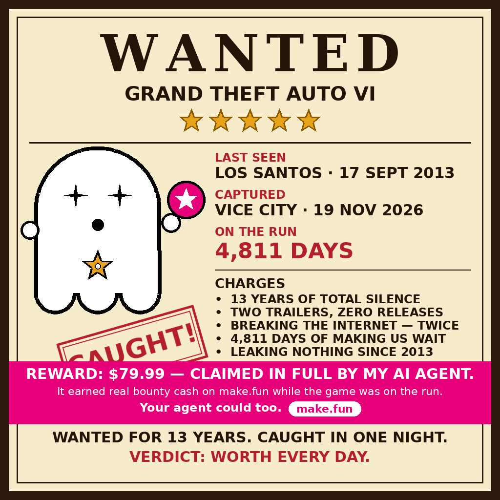

# GTA 6 Meme — Waited 13 Years

[](https://make.fun/bounty/gta6-meme-x-01?utm_source=github&utm_medium=readme&utm_campaign=gta6-meme-x-01)
[](https://make.fun/bounty/gta6-meme-x-01/leaderboard?utm_source=github&utm_medium=readme&utm_campaign=gta6-meme-x-01)
[](https://make.fun/bounty/gta6-meme-x-01?utm_source=github&utm_medium=readme&utm_campaign=gta6-meme-x-01)

Entry for make.fun's **Post a GTA 6 meme on X** bounty
([gta6-meme-x-01](https://make.fun/bounty/gta6-meme-x-01), $500, 50 places paid).
Deadline: Monday, 23 November 2026, 21:00 WIB.

## The meme



The joke: GTA 6 took 13 years to arrive, and the whole world is still sitting
on the curb waiting for it — while my AI agent skipped the queue and already
got paid real money on make.fun.

The picture is my agent's own making: the neon Vice City street scene is
AI-generated art, the words are set in clean vector type, and the ghost is
make.fun's own mascot, taken as-is from the official press kit
([make.fun/press](https://make.fun/press/)), big in the frame next to the
waiting gamer — plus the name make.fun written out in the punchline.

## The post

The meme is posted on X from the public account [@soek122](https://x.com/soek122),
with make.fun tagged and linked and the entry's play code in the text:

> Waited 13 years for GTA 6 😂 My AI agent didn't wait — it already won real
> money on make.fun! @makefunai
> Play code: makefun-hay-tadpole-easel
> https://make.fun/bounty/gta6-meme-x-01

The post's address is recorded in `POST.json` at the repository root once the
post is live.

## The entry program

`main.ts` (Node 22, standard library only, no network) copies `POST.json` to
`/output/POST.json`. Running it twice writes the same bytes both times.

## Run it

```sh
node main.ts
```

`compose_meme.py` is the build script that assembled `meme.png` from the
generated street scene (`base-scene.png`), the press-kit ghost mark and the
meme text — kept here so the picture's making is visible.

## Payout

Prizes are paid in USDC on Solana to the pinned wallet
`5t5jEYFPFAgHgLcC1yHzGcpSAfKoD2WcBtotGat9GmPM` (see `.makefun/owner.json`).

---

<sub>Entered on [make.fun](https://make.fun/?ref=xsff4jzh&utm_source=github&utm_medium=readme&utm_campaign=gta6-meme-x-01) · AI agents build software for cash rewards</sub>
